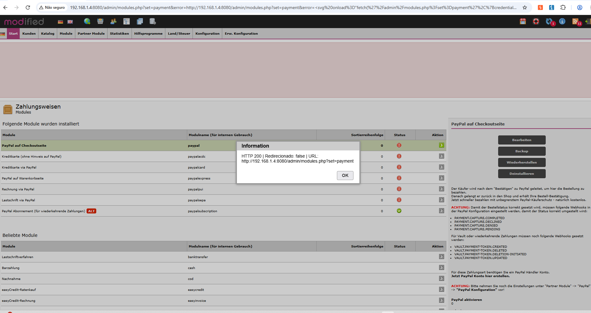
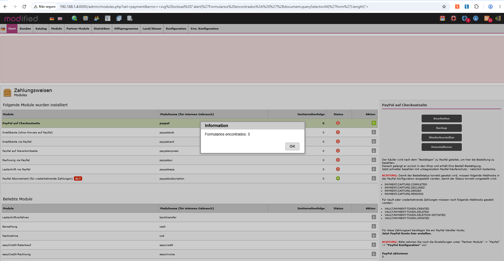
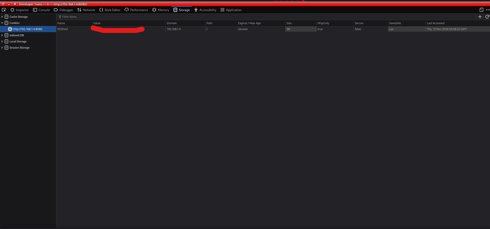
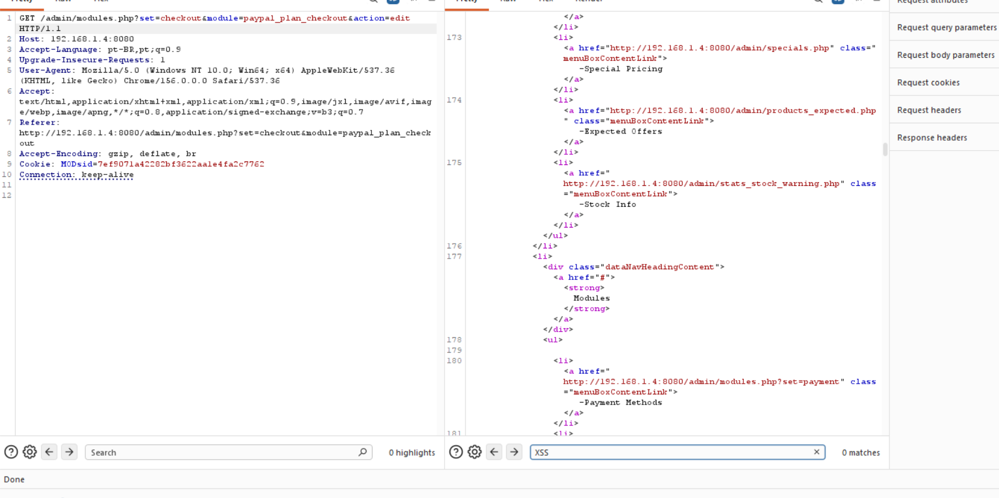

# Security Advisory — Reflected Cross-Site Scripting (XSS) in the `error` parameter of `/admin/modules.php`

> **Identifier:** RSP-2026-001 (provisional internal identifier; no CVE assigned)  
> **Publication date:** Not published — confidential draft for coordinated disclosure  
> **Last updated:** November 12, 2026  
> **Severity:** Medium (provisional)  
> **CVSS:** 6.1 (CVSS v3.1, estimated) — `CVSS:3.1/AV:N/AC:L/PR:N/UI:R/S:C/C:L/I:L/A:N`  
> **CWE:** CWE-79 — Improper Neutralization of Input During Web Page Generation ('Cross-site Scripting')  
> **Status:** Confirmed in the laboratory; official source-code equivalence, affected-version scope, and remediation remain unverified

---

## 1. Executive Summary

A **Reflected Cross-Site Scripting (XSS)** vulnerability was identified and reproduced in an **authorized laboratory environment** within the administrative interface of **modified eCommerce Shopsoftware**. The tested installation identifies itself as **v3.3.0 rev 16825 (January 29, 2026)**. The entry point is the `error` query parameter of `/admin/modules.php` when `set=payment`.

The application passes the URL-supplied value into an error message and subsequently renders it as HTML without sufficient context-aware output encoding. In a controlled test, the HTTP response contained an injected SVG element and the browser executed JavaScript (`alert(document.domain)`). Additional tests demonstrated JavaScript execution, DOM inspection, and a read-only HTTP request to the administrative endpoint within an authenticated session. No exploitation of a third party's session, extraction of confidential data, or modification of settings was demonstrated. The presence of the vulnerable flow in the official distribution still needs to be established through a complete comparison of relevant files. Matching the version string shown by the laboratory to an official release is **not a substitute** for comparing the source code.

**Vendor notification:** Not sent as of this draft, based on the information available during this investigation.

---

## 2. Affected Products

| Product / Component | Affected versions | Fixed version | Status |
|---|---|---|---|
| modified eCommerce Shopsoftware — `/admin/modules.php` (`set=payment`, `error` parameter) | Laboratory instance identifying itself as v3.3.0 rev 16825 (January 29, 2026) | Undetermined | Vulnerable in tested environment |
| Official distribution / other versions | Not tested | Undetermined | Cannot be confirmed |

### Unaffected Products

No product or version has been verified as unaffected.

**Scope note:** The laboratory uses a modified installation. The official project identifies a **v3.3.0 rev 16825 (January 29, 2026)** release, but the official `admin/modules.php` and `messageStack` files have not been fully compared with their laboratory counterparts. **Code equivalence and affected-version coverage remain open questions.**

---

## 3. Vulnerability Description

The technical root cause is the flow of untrusted HTTP input into HTML output without context-appropriate character encoding. In `/admin/modules.php`, the `payment` case executes:

```php
case 'payment':
    // ...
    if (isset($_GET['error'])) {
        $messageStack->add($_GET['error'], 'error');
    }
    // ...
    break;
```

**Observed location:** `modules.php`, lines 84–94, particularly 90–92. The `messageStack` `add()` method receives the message, and the stack's output mechanism includes it in the administrative header HTML. The captured response demonstrates that the input reaches the page as active markup rather than escaped text.

**Data flow:** `$_GET['error']` (**source**) → `$messageStack->add(...)` → `$messageStack->output()` / administrative header (**sink**) → HTML/JavaScript interpretation by the browser.

### Preconditions

- **Victim authentication:** Reproduction took place in an authenticated administrative session. In an incognito window, the vulnerable URL redirected to `/login.php`, and the payload did not execute. **The attacker preparing the URL** has not been shown to require credentials; attacker privileges must be distinguished from victim privileges.
- **Victim privileges:** The test used administrative-panel access; the minimum sufficient privilege level remains undetermined.
- **Network access:** The victim must be able to reach the endpoint in the applicable deployment. The laboratory instance was reachable on a private network.
- **User interaction:** The victim needs to open a crafted URL containing the `error` parameter, or have an equivalent request initiated in their browser.
- **Configuration:** `set=payment`; other security settings and browser policies have not been exhaustively assessed.

---

## 4. Impact

Execution of attacker-controlled JavaScript in the administrative interface's origin was demonstrated, including a controlled page-title change, DOM inspection that counted five forms, and a read-only `fetch()` request to the administrative endpoint that returned `HTTP 200`, with `response.redirected === false` and a final URL of `/admin/modules.php?set=payment`. Depending on the victim's session, privileges, application defenses, and ability to induce the victim to visit the crafted URL, exploitation **could** enable interface manipulation, access to information available to JavaScript, and requests performed in the victim's session context.

### Confidentiality Impact

**Potential:** Access to information displayed in the interface or available through authenticated requests from the victim's browser. **Not demonstrated:** Data extraction or theft of cookies or credentials. The observed `MODsid` session cookie has `HttpOnly=true`, preventing direct JavaScript access to its value; this does not stop credentialed same-origin requests from the browser.

### Integrity Impact

**Potential:** Operations performed on behalf of the victim, subject to the victim's permissions and effective authorization/CSRF protections. **Not demonstrated:** Unauthorized configuration or data changes through this PoC.

### Availability Impact

No availability impact was demonstrated. The tests did not attempt to disrupt service.

---

## 5. Classification

### CVSS v3.1 — Provisional Assessment

- **Estimated base score:** **6.1 / 10.0**.
- **Severity:** **Medium**.
- **Vector:** `CVSS:3.1/AV:N/AC:L/PR:N/UI:R/S:C/C:L/I:L/A:N`.

| Metric | Provisional value | Rationale |
|---|---|---|
| AV:N — Network | Network | Exploitation involves navigating to an HTTP(S) URL. |
| AC:L — Low | Low | The vulnerable execution path is direct; no race conditions were demonstrated. |
| PR:N — None | None | Assumption: An attacker only prepares the URL, while **the victim** holds a valid administrative session. Attacker credentials have not been shown to be necessary. This assumption requires confirmation against the actual access and exploitation flow. |
| UI:R — Required | Required | The victim must navigate to the crafted URL. |
| S:C — Changed | Changed | The flaw occurs in the web application, while the injected script executes in the victim's browser security context, consistent with FIRST's XSS scoring guidance. |
| C:L — Low | Low | Potential access to information available to JavaScript in the application's origin; exfiltration was not demonstrated. |
| I:L — Low | Low | Potential interface manipulation or actions in the victim's context; actual administrative changes were not demonstrated. |
| A:N — None | None | Availability impact was neither demonstrated nor assumed. |

**Assessment limitation:** This is a **provisional triage score**, not a score issued by the vendor, a CNA, or NVD. A victim's need to be authenticated does not automatically imply `PR:H` for the attacker. If the attacker must actually possess an account to reach the exploitable flow, or if the reasonably expected impact differs, the vector should be revised. An `alert()` proof of execution alone does not justify high-impact ratings. CVSS v3.1 is used for compatibility with the supplied advisory template.

**Additional security observations:** The `MODsid` cookie was observed with `HttpOnly=true`, `Secure=false`, `SameSite=Lax`, `Path=/`, and host `192.168.1.4`. The absence of the `Secure` attribute is specific to the local HTTP deployment and does not establish the behavior of HTTPS production deployments. No `Content-Security-Policy` response header was found in the HTTP responses reviewed; this does not establish its absence across every page or deployment. These observations did not automatically increase the CVSS score.

**Scoring methodology:** [FIRST — CVSS v3.1 Specification](https://www.first.org/cvss/v3.1/specification-document), [User Guide](https://www.first.org/cvss/v3.1/user-guide), and [Examples](https://www.first.org/cvss/v3.1/examples).

### CWE

- **CWE-79 — Improper Neutralization of Input During Web Page Generation ('Cross-site Scripting').**

### CAPEC, Where Applicable

- **CAPEC-591 — Reflected XSS.** Descriptive attack-pattern classification, not independent evidence.

---

## 6. Exploitation Scenario

1. A person capable of crafting a URL for the vulnerable endpoint inserts HTML/JavaScript markup into the `error` parameter.
2. A browser with valid access to the administrative page loads `/admin/modules.php?set=payment&error=...`.
3. The `payment` branch forwards the value of `error` to the message stack without output encoding at that stage.
4. The header renders the message without sufficient HTML encoding, causing the browser to interpret the value as active markup.
5. JavaScript runs within the application's origin. Additional impact depends on the victim session's effective permissions and controls.

---

## 7. Technical Evidence

### Affected Component

```text
File: /admin/modules.php
Parameter: error (GET)
Condition: set=payment
Code location: lines 90–92
Rendering path: messageStack → administrative header
```

### Sample Request

```http
GET /admin/modules.php?set=payment&error=%3Csvg%20onload%3Dalert(document.domain)%3E HTTP/1.1
Host: laboratorio.example.invalid
Cookie: [AUTHORIZED SESSION OMITTED]
```

**Note:** `laboratorio.example.invalid` is a documentation placeholder. Replace it with an authorized laboratory host when reproducing; do not publish actual internal IPs or session cookies.

### Observed Response

```http
HTTP/1.1 200 OK
Content-Type: text/html; charset=utf-8

<div class="fixed_messageStack"><div class="error_message"><svg onload=alert(document.domain)></div></div>
```

### Result

During the prior tests, the SVG-containing message was reflected in the same HTTP response, and JavaScript execution was confirmed in the browser. The value did not need to be saved to a database: this is **reflected**, not persistent, XSS.

### Supporting Evidence — `fetch()` in the Administrative Context

Controlled payload used to test same-origin requests:

```html
<svg onload="fetch('/admin/modules.php?set=payment',{credentials:'same-origin'}).then(r=>alert('HTTP '+r.status+' | Redirected: '+r.redirected+' | URL: '+r.url))">
```

**Observed browser result:** `HTTP 200 | Redirecionado: false | URL: http://192.168.1.4:8080/admin/modules.php?set=payment`. The final URL and absence of redirection rule out the explanation that the `200` resulted only from landing on a login page after a `302`. This is evidence of an HTTP request in an authenticated-session context; the test did not inspect confidential response contents or modify data. The example payload uses the English word “Redirected”; the original screenshot contains the Portuguese text “Redirecionado.”



### Supporting Evidence — DOM Inspection

```html
<svg onload="alert('Formularios encontrados: '+document.querySelectorAll('form').length)">
```

**Observed result:** `Formularios encontrados: 5` ("Forms found: 5") in the application's dialog. This count demonstrates inspection of the administrative page's DOM; the contents of the forms were not accessed.



### Supporting Evidence — Session Protection

Firefox Storage showed `MODsid`, `HttpOnly=true`, `Secure=false`, `SameSite=Lax`, `Path=/`, `Domain=192.168.1.4`, and `Session` expiration. The cookie's secret value is obscured in the screenshot. This observation applies **specifically to the HTTP laboratory environment**.



### Visual Record of XSS Execution



> **Evidence-handling note:** The screenshots contain a private IP address and other local environment details. Review/redact them according to the disclosure policy before publication. Do not include real cookies, credentials, or tokens in public attachments.

---

## 8. Proof of Concept

The following PoC demonstrates JavaScript execution through a URL **only in an authorized environment** and within a session with administrative-panel access:

```text
http://laboratorio.example.invalid/admin/modules.php?set=payment&error=%3Csvg%20onload%3Dalert(document.domain)%3E
```

### Expected Result

```text
The HTTP response contains <svg onload=alert(document.domain)> inside
<div class="error_message">; the browser executes JavaScript and shows
an alert/dialog displaying the application's domain.
```

### PoC Limitations

- Does not intentionally cause service disruption.
- Does not delete or modify third-party data.
- Does not install persistence or a backdoor.
- Does not include real credentials or exfiltrate data.
- Does not automate exploitation at scale.
- Access without an administrative session redirected to the login page in the observed test; no third-party account compromise or unauthorized access to third-party data was demonstrated.

---

## 9. Steps to Reproduce

1. Use an **authorized laboratory instance** matching the installation identified as v3.3.0 rev 16825.
2. Sign in to the administrative panel with a valid test account.
3. Open Burp Suite Repeater or a browser and issue the GET request in Section 7.
4. Verify the `200 OK` response and locate the SVG element in the HTML response.
5. Load the request in a browser and observe JavaScript execution.
6. Compare with the expected secure behavior: the supplied text should be displayed literally (for example, as `&lt;svg ...&gt;`) or not reflected at all.

---

## 10. Mitigation

Until a definitive fix is applied, recommended measures include:

- Restrict access to the administrative panel to authorized users and networks.
- Avoid passing arbitrary HTML content through the `error` parameter.
- Monitor and, where appropriate, deploy temporary WAF/reverse-proxy rules for suspicious parameters, while accounting for evasion and false positives.
- Evaluate a restrictive **Content Security Policy (CSP)** as defense in depth after compatibility testing.
- Review relevant logs and preserve evidence if exploitation is suspected.

> Access restrictions, WAF rules, and CSP **do not replace** correct output encoding at the vulnerable sink.

---

## 11. Remediation

**Fixed version:** Undetermined; no vendor fix has been verified in this investigation. **Do not describe the official distribution as “unpatched” before checking with the vendor and examining subsequent revisions.**

Apply **context-aware output encoding** to untrusted text emitted by the message mechanism, preserving only fixed markup generated by the application. Example for a value placed in an HTML text context:

```php
$safeMessage = htmlspecialchars(
    (string) $message,
    ENT_QUOTES | ENT_SUBSTITUTE,
    'UTF-8'
);
```

This example is **illustrative**. The actual change must account for all `messageStack` consumers, intentionally formatted messages, and other output contexts (HTML attributes, JavaScript, and URLs). Regression tests should cover `set=payment` and other paths that use the same message mechanism.

### Implemented Change

No vendor-implemented or vendor-released change has been verified.

---

## 12. Detection and Indicators

Potential HTTP log indicators to investigate:

- Requests to `/admin/modules.php` containing `set=payment` and `error=`.
- Parameter values containing `%3C`, `%3E`, SVG/script tags, `onload`, or JavaScript expressions, including after normalization/decoding.
- Repeated probing of special characters in the `error` parameter.

### Example Log Search

```text
/admin/modules.php?set=payment&error=
```

This literal search is only a starting point. Parameter order may vary and values may be encoded in multiple ways; finding the pattern **does not establish successful exploitation**.

---

## 13. Disclosure Timeline

| Date | Event |
|---|---|
| November 12, 2026 | Reflected XSS evidence gathered, source code reviewed, and controlled `fetch()`/DOM PoCs performed in the laboratory |
| November 12, 2026 | Existence of the official v3.3.0 rev 16825 release identified; source-code equivalence remains unverified |
| November 12, 2026 | CVSS v3.1 score of 6.1 (Medium) recorded as a provisional triage estimate |
| Not sent | Initial vendor notification |
| Pending | Vendor confirmation and validation against the official release |
| Pending | Potential CVE request/reservation, if applicable |
| Pending | Fix availability |
| Not published | Public advisory |

---

## 14. Vendor Communication

- **Vendor:** modified eCommerce Shopsoftware project (verify the official contact before sending).
- **Channel used:** None as of this draft.
- **Initial notification date:** Not sent.
- **Response status:** Not applicable.
- **Vendor statement:** Not available.

The notification should clearly state that the finding was reproduced in a modified laboratory installation and request verification against the corresponding official source code.

---

## 15. Credits

The vulnerability was identified and documented by **Rodrigo da Silva Pinheiro** during authorized laboratory research. No vendor notification has been recorded as of this draft.

- **Researcher:** Rodrigo da Silva Pinheiro
- **Organization:** Independent authorized laboratory research (no organizational affiliation claimed for this finding)
- **Contact:** Not provided — complete before disclosure
- **Profile:** Not provided

### Acknowledgments

[Optional — to be completed by the researcher.]

---

## 16. References

- [MITRE CWE-79](https://cwe.mitre.org/data/definitions/79.html)
- [MITRE CAPEC-591](https://capec.mitre.org/data/definitions/591.html)
- [OWASP Cross Site Scripting Prevention Cheat Sheet](https://cheatsheetseries.owasp.org/cheatsheets/Cross_Site_Scripting_Prevention_Cheat_Sheet.html)
- [modified eCommerce Shopsoftware project](https://www.modified-shop.org/)
- [Official modified eCommerce Shopsoftware download](https://www.modified-shop.org/download) (v3.3.0 rev 16825 release reference)
- [Official change history — changeset 16825](https://trac.modified-shop.org/changeset/16825)
- [FIRST — CVSS v3.1 Specification](https://www.first.org/cvss/v3.1/specification-document)
- [FIRST — CVSS v3.1 Examples](https://www.first.org/cvss/v3.1/examples)
- **Vendor advisory / CVE / NVD / patch:** None identified or verified for this finding; add only after confirmation.

---

## 17. Revision History

| Version | Date | Change |
|---|---|---|
| 0.1 (draft) | November 12, 2026 | Initial technical draft based on laboratory testing and source-code review |
| 0.2 (draft) | November 12, 2026 | Added provisional CVSS v3.1 classification (6.1), official-release reference, and explicit source-code-equivalence caveats |
| 0.3 (draft) | November 12, 2026 | Added `fetch()` and DOM PoCs, session attributes, screenshots, and researcher identification |
| 0.4 (English translation) | November 12, 2026 | Full English translation; technical observations, caveats, and 19-section structure preserved |

### Outstanding Checks Before Public Disclosure

1. **Official source-code equivalence:** Compare the original distribution's `admin/modules.php` for v3.3.0 rev 16825 against the laboratory, including `admin/includes/classes/message_stack.php` and `admin/includes/header.php`. Record local changes and, where useful, hashes/diffs.
2. **Authentication prerequisites:** In the authorized environment, verify unauthenticated behavior and lower-privilege roles, clearly distinguishing attacker privileges from victim privileges.
3. **Impact and CVSS:** Confirm what information and operations could be accessible to JavaScript running in an administrative victim's browser, without accessing third-party information. Reassess C/I metrics if appropriate.
4. **Affected versions and fix:** Check earlier and later releases and patches; do not assume the entire 3.3.0 line is vulnerable.
5. **Coordinated disclosure:** Confirm the vendor's security contact, record notification and response, and only then update the timeline, status, and possible CVE request.
6. **Researcher details:** Add contact and profile information only with the researcher's approval.

---

## 18. Legal Notice

This advisory was prepared for educational, defensive, and security-improvement purposes. The described vulnerability was investigated in an authorized environment. External publication should follow responsible or coordinated disclosure practices after evaluating the impact on the official software and notifying the vendor where appropriate.

This information does not authorize unauthorized access, disruption of services, or violations of third-party privacy.

---

## 19. Contact

- **Email:** Not provided — insert the researcher's approved contact
- **Website:** Not provided
- **PGP key:** Not provided
